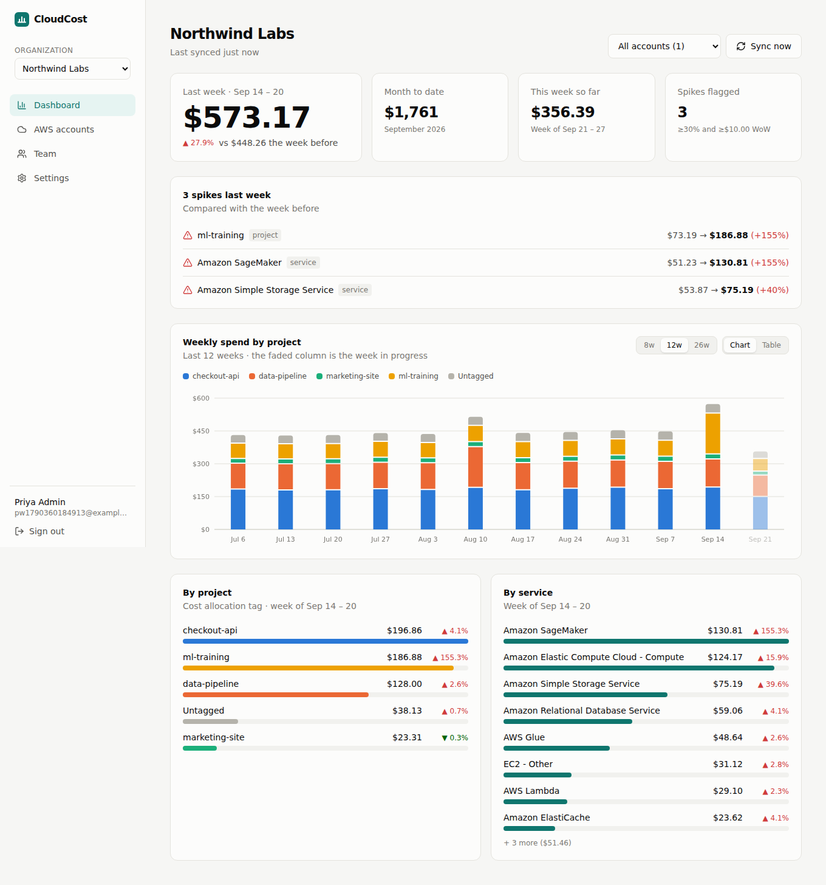
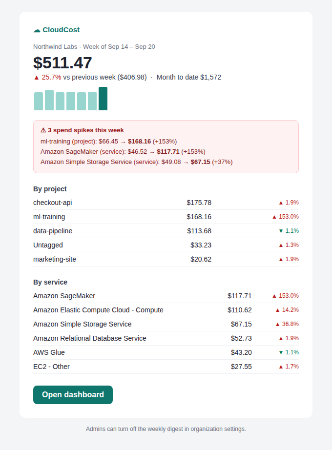
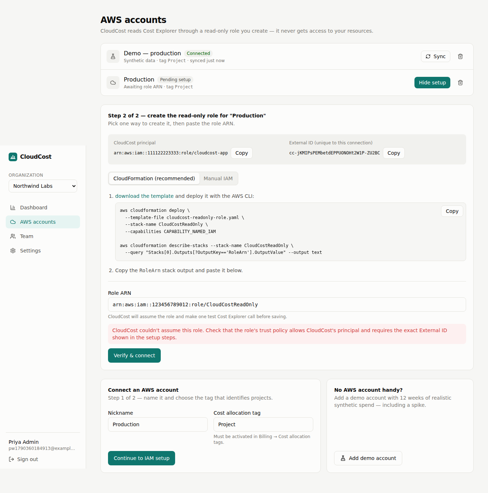

# CloudCost

**Weekly AWS spend by project, for engineering teams.** CloudCost connects to an AWS account through a read-only cross-account IAM role, pulls Cost Explorer data on a schedule, and gives each organization a dashboard (spend by project tag and by service, week-over-week trends, month-to-date), automatic spike detection and a Monday digest email.

> Portfolio project: a multi-tenant SaaS with a real AWS integration, background jobs and a production-minded API. See **[docs/aws-cross-account-iam.md](docs/aws-cross-account-iam.md)** for the write-up on the cross-account trust model and the confused-deputy problem.



## Features

- **Organizations & roles.** Sign up creates an org; invite teammates by email (hashed, single-use, 7-day tokens); admin/member roles; last-admin protection. Every org-scoped route goes through one guard, and non-members get `404`, not `403`.
- **Connect AWS without keys.** Per-connection ExternalId generated server-side, a one-click CloudFormation template (or copy-paste JSON policies), and a verify step that assumes the role and makes a test call before saving it.
- **Weekly ingestion.** BullMQ worker with a daily repeatable job: one `GetCostAndUsage` call per account per week, grouped by *(Project tag, service)* at daily granularity, then folded into project / service / day views. Idempotent upserts; a 12-week backfill on connect.
- **Dashboard.** Last week's total vs the week before, month-to-date, week-in-progress, stacked weekly trend by project (with a table view), and ranked project/service breakdowns. Multiple AWS accounts roll up into one view, or filter to one.
- **Spike detection.** A project/service is flagged when it grows ≥ X% *and* ≥ $Y week over week (both configurable per org). Brand-new line items are flagged too.
- **Monday digest.** HTML + plain-text email to every member: total, change, spikes, top projects and services. Idempotent per org per week.
- **Demo mode.** A deterministic synthetic provider, so anyone can try the product (or develop locally) without an AWS account.

| Weekly digest email | Connecting an AWS account |
|---|---|
|  |  |

## Stack

| Layer | Choice |
|---|---|
| Web | Next.js 16 (App Router), React 19, TypeScript, Tailwind CSS v4, SWR; hand-rolled SVG charts |
| API | NestJS 11, TypeScript, Zod validation, argon2id + JWT in an httpOnly cookie, Helmet, rate limiting |
| Data | PostgreSQL 16 with Drizzle ORM + SQL migrations |
| Jobs | Redis + BullMQ (separate worker process, job schedulers, retries with backoff) |
| AWS | SDK v3 — STS `AssumeRole`, Cost Explorer `GetCostAndUsage` |
| Email | Nodemailer over SMTP (Mailpit locally; SES / Resend SMTP in production) |
| Tests | Jest — unit tests + an end-to-end suite against real Postgres and Redis (AWS mocked with `aws-sdk-client-mock`) |
| DevOps | Docker (multi-stage, non-root), Docker Compose, GitHub Actions CI |

## Architecture

```
Browser ──▶ Next.js (web) ──/api/* rewrite──▶ NestJS API ──▶ PostgreSQL
                                                  │  enqueue            ▲
                                                  ▼                     │ upsert snapshots
                                                Redis ◀──── BullMQ worker ──STS──▶ customer role ──▶ Cost Explorer
                                                                 │
                                                                 └──SMTP──▶ weekly digest
```

- The browser only ever talks to the Next.js origin; `/api/*` is proxied to the API, so the session cookie is first-party in every environment.
- API and worker are **the same image with different entrypoints** (`dist/main.js`, `dist/worker.js`), so they scale independently.
- Schedules are registered with `upsertJobScheduler`, which is idempotent: running several worker replicas never duplicates the digest.

```
apps/
  api/                 NestJS API + worker
    src/auth/          signup/login, JWT cookie, global guard
    src/orgs/          orgs, members, invites, tenant guard
    src/aws/           role setup + connect, STS, Cost Explorer + demo providers
    src/costs/         snapshot ingestion, anomaly detection, dashboard aggregation
    src/jobs/          BullMQ queues, processors, schedules
    src/mail/          email layout + digest/invite templates
    drizzle/           SQL migrations
    test/              e2e suite
  web/                 Next.js app (landing, auth, dashboard, accounts, team, settings)
infra/iam/             customer-side CloudFormation template
docs/                  design notes
```

## Data model

`organizations` · `users` · `org_members (org_id, user_id, role)` · `invites` · `aws_accounts (org_id, role_arn, external_id, cost_tag_key, status, …)` · `cost_snapshots (aws_account_id, week_start, total_cost, breakdown_json, anomalies, is_complete)` — one row per account per ISO week (Monday, UTC), unique on `(aws_account_id, week_start)`.

## Running locally

Prerequisites: **Node 20.9+** (22 recommended) and **Docker Desktop**.

```bash
npm install
docker compose up -d                 # Postgres, Redis, Mailpit
cp apps/api/.env.example apps/api/.env   # Windows: copy apps\api\.env.example apps\api\.env
npm run db:migrate
npm run dev                          # API :4000, worker, web :3000
```

Open http://localhost:3000, create an organization, and click **Add demo account** — 12 weeks of data appear within a few seconds. Emails (invites, digests) land in Mailpit at http://localhost:8025.

To run everything in containers instead: `docker compose --profile app up --build`.

### Connecting a real AWS account

1. In the AWS account CloudCost runs as, set `CLOUDCOST_PRINCIPAL_ARN` in `apps/api/.env` to that IAM role/user ARN, and make sure the API/worker have its credentials (e.g. `AWS_PROFILE`).
2. In the account to be monitored: enable Cost Explorer, and activate the `Project` cost allocation tag (*Billing → Cost allocation tags*).
3. In CloudCost: *AWS accounts → Connect*, deploy the generated CloudFormation template, paste the `RoleArn` output.

### Tests

```bash
npm test             # unit tests (week math, anomaly rules, Cost Explorer parsing, STS/CE via aws-sdk-client-mock, IAM templates)
npm run test:e2e     # full API flow against Postgres + Redis (uses TEST_DATABASE_URL, default …/cloudcost_test)
npm run lint && npm run typecheck && npm run build
```

The `cloudcost_test` database is created automatically the first time the Compose Postgres volume initialises.

## API overview

| Method & path | Who |
|---|---|
| `POST /auth/signup` · `POST /auth/login` · `POST /auth/logout` · `GET /auth/me` | public / signed in |
| `GET /orgs` · `POST /orgs` | signed in |
| `GET /orgs/:orgId` · `PATCH /orgs/:orgId` | member · admin |
| `GET /orgs/:orgId/members` · `PATCH/DELETE /orgs/:orgId/members/:userId` | member · admin |
| `GET/POST /orgs/:orgId/invites` · `DELETE /orgs/:orgId/invites/:id` | admin |
| `GET /invites/:token` · `POST /invites/:token/accept` | public · signed in |
| `GET/POST /orgs/:orgId/aws-accounts` · `GET …/:id/setup` · `POST …/:id/connect` · `POST …/:id/sync` · `DELETE …/:id` | member / admin |
| `GET /orgs/:orgId/dashboard?weeks=12&accountId=` | member |
| `GET /health` | public |

## Design notes

- **Anomalies only on complete weeks.** Comparing a half-finished week against a full one would flag everything as a drop. The in-progress week is shown faded and excluded.
- **Dollar floor on spikes.** `$0.40 → $1.20` is +200% and irrelevant; the `minDelta` floor keeps the signal meaningful.
- **Cost Explorer revises recent days.** The daily job re-pulls last week as well as the current one, so late adjustments are picked up.
- **Chart colours** follow a CVD-validated categorical order (checked for colour-blind separation in light and dark), assigned by project name rather than rank so a project keeps its colour across weeks; *Untagged* is always neutral grey.

## Roadmap

- Terraform: ECS Fargate (api + worker services), RDS Postgres, ElastiCache Redis, ALB, SES, CloudWatch dashboards and alarms; deploy job in GitHub Actions; dogfood on CloudCost's own bill.
- Stripe billing (free: 1 account / 4 weeks history), Slack anomaly alerts, comments on cost reports with live updates.
